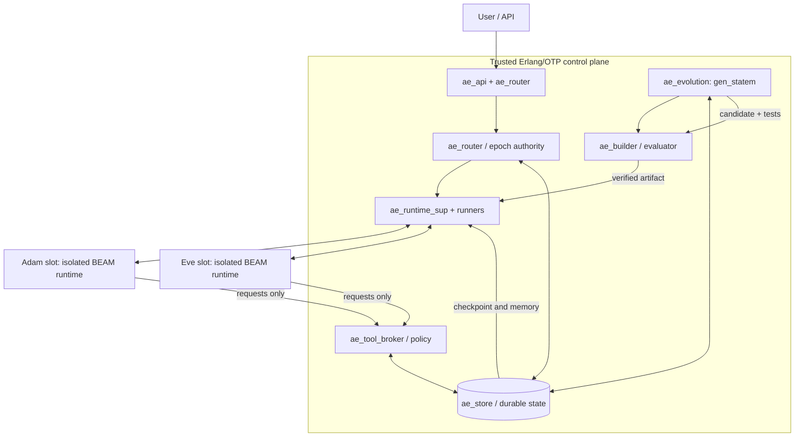

# adam-eve — Self-Evolving AI Agent

**Document:** Architecture and Software Requirements Specification  
**Version:** 0.1 (MVP design)  
**Status:** Draft  
**Primary platform:** Erlang/OTP (BEAM)  
**Guiding principle:** Start with a minimal agent; preserve a trusted substrate so that the agent can safely evolve its own replaceable implementation.

## 1. Vision

adam-eve is a continuously available, self-evolving AI agent. Two execution slots, **Adam** and **Eve**, alternate in serving users. The active agent proposes and authors improvements to the inactive slot, while a stable controller independently builds, tests, and promotes the candidate. Each generation inherits the same durable identity—conversation, memory, preferences, tasks, and learned knowledge—without requiring the runtime process to survive.

**Core rule:** *The agent may evolve its implementation; it may not unilaterally change the mechanism that judges, isolates, deploys, or rolls back that implementation.*

## 2. Scope

### Goals

- G1 — Bootstrap from a deliberately minimal seed agent, with only user I/O, LLM invocation, memory access, and a proposal interface.
- G2 — Allow the active agent to generate source patches for its inactive counterpart.
- G3 — Build and evaluate each candidate in an isolated environment before any production effect.
- G4 — Switch user traffic between Adam and Eve without losing committed conversation state or acknowledged work.
- G5 — Support failed-upgrade rollback and recovery from agent crashes.
- G6 — Keep a reproducible audit trail of source revisions, artifacts, evaluations, memory schemas, and promotions.
- G7 — Support progressively richer agent strategies, tools, and workflows without modifying the trusted controller.

### Non-goals for v0.1

- Training or modifying the underlying foundation model weights.
- Allowing unrestricted self-modification of controller, security policy, validation harness, or production credentials.
- Zero interruption of every in-flight streamed response during a swap; MVP may finish or retry at well-defined boundaries.
- Distributed multi-host consensus, multiple active identities, or autonomous privilege expansion.
- Guaranteeing that every accepted code change improves general intelligence.

## 3. Identity and Terms

- **Logical agent:** One user-facing identity and one durable memory namespace across all generations.
- **Slot:** Adam (`adam`) or Eve (`eve`); slot names are stable, but implementation versions change.
- **Active:** The only slot eligible to receive new user turns and authorized side-effectful tools.
- **Standby:** A candidate or previous version with no production side-effect privileges.
- **Generation:** An immutable source/artifact version identified by content hash and lineage.
- **Epoch:** Monotonically increasing routing/authorization version; stale epochs are rejected.
- **Seed:** Smallest working implementation of the evolvable agent contract.
- **Controller:** Immutable-for-agent trusted OTP application responsible for lifecycle and safety.

## 4. Architecture



### 4.1 Isolation boundary

The control plane is a trusted Erlang/OTP release. **Each agent slot is a separate OS process/BEAM runtime, preferably an isolated container.** An OTP supervisor monitors a local runner/port-owner process, which monitors and manages the external runtime; a normal OTP supervisor does **not** directly supervise a remote BEAM node as a child. Candidate code must not be loaded into the controller VM.

Use authenticated local IPC (Unix domain socket for single-host MVP, with strict message schemas). Do not grant untrusted agent slots general distributed Erlang access to the controller: Erlang distribution is for mutually trusted nodes, not a sandbox or fine-grained capability boundary.

### 4.2 Trusted OTP components

| Module | OTP role | Responsibility |
|---|---|---|
| `ae_app` | `application` | Start controller application. |
| `ae_sup` | `supervisor` | Root supervision, preferred `rest_for_one` by dependency order. |
| `ae_store` | `gen_server` / storage adapter | Durable events, snapshots, routing, metadata, atomic transitions. |
| `ae_runtime_sup` | `supervisor` | Dynamically supervise `ae_runtime_worker` children. |
| `ae_runtime_worker` | `gen_server` | Start/monitor/stop an external BEAM runtime; health/IPC. |
| `ae_router` | `gen_server` | User-turn routing; single active slot; admission/draining. |
| `ae_tool_broker` | `gen_server` | Authorize and execute narrowly scoped tool requests. |
| `ae_evolution` | `gen_statem` | Candidate lifecycle and controlled promotion/rollback. |
| `ae_builder` | supervised job worker | Build signed/content-addressed candidate artifacts. |
| `ae_evaluator` | supervised job worker | Independent test harness and score comparisons. |
| `ae_api` | HTTP/WebSocket handler | Stable external user API; streaming optional. |

`ae_policy` should be a trusted, stateless policy library used by router, broker, and evaluator. A runner crash is not itself proof that the code is defective: restart policies should be bounded and failures recorded.

### 4.3 Agent-side minimal modules

| Module | Purpose |
|---|---|
| `seed_app` / `seed_sup` | Boot seed runtime. |
| `seed_agent` (`gen_server`) | Receive a user turn, fetch context, invoke the configured LLM, reply. |
| `seed_evolver` | Produce structured candidate patch proposals using the LLM. |
| `seed_contract` | Versioned wire protocol and state-envelope implementation. |

The initial seed should have **no direct filesystem writes to a live deployment, no shell execution, and no privileged deployment API**. Its evolutionary capability is the ability to request a structured code patch, which the controller applies to an isolated candidate workspace.

## 5. Mandatory invariants

1. **Single active writer:** At most one active generation per logical identity/epoch. The gateway and tool broker reject stale epochs.
2. **Independent judge:** An agent cannot edit or execute its own production evaluation policy, secrets, controller, or deployment mechanism.
3. **Durable-before-ack:** A user turn or tool result is not acknowledged as committed until its durable event is saved.
4. **No hidden process-state dependency:** Anything required for continuity must be present in durable events or versioned checkpoints.
5. **Immutable artifacts:** Every promoted generation refers to a pinned, content-addressed, reproducible artifact.
6. **Reversible routing:** Promotion never destroys the last known-good code or its compatible checkpoint.
7. **Controlled effects:** Every external side effect goes through a broker with authorization, idempotency, and audit logging.
8. **Bounded evolution:** Limit concurrent proposals, attempts, execution time, resource consumption, and spending.

## 6. Evolution lifecycle

### 6.1 State machine

Implement `ae_evolution` with `gen_statem`:

`idle → proposing → building → testing → staging → quiescing → promoting → observing → idle`

Failure paths: `building/testing/staging → rejected → idle`; `quiescing/promoting/observing → rollback → idle`; unrecoverable faults → `degraded` with human intervention.

### 6.2 Detailed sequence

1. **Trigger:** A user command, recurring budgeted schedule, or regression signal requests improvement. Only one evolution job per logical identity is accepted.
2. **Propose:** Active slot generates a patch targeting only permitted files/modules and records an explicit hypothesis, expected benefit, risks, and test plan.
3. **Build:** Controller checks patch scope, creates a new Git revision/artifact, compiles in a restricted sandbox, and runs static checks.
4. **Evaluate:** Controller runs unit, contract, security, replay, regression, and objective-specific behavioral tests using isolated/mock tools and synthetic or redacted state. Candidate cannot mutate production state.
5. **Compare:** Candidate must satisfy hard safety invariants and meet an explicitly configured quality gate against the currently active baseline. Test definitions and private evaluation cases are not editable by candidates.
6. **Stage:** Controller starts candidate in inactive slot, checks handshake, state schema compatibility, readiness, and simulated user turns. All side-effectful operations remain disabled.
7. **Quiesce:** Router stops admitting new turns to old active slot; in-flight turns complete or become durable retryable tasks under an explicit timeout. Persist a high-watermark event sequence and checkpoint.
8. **Restore:** Candidate restores from checkpoint plus events after the snapshot, validates compatibility, and reports ready. It must not execute production effects yet.
9. **Promote:** Controller atomically commits `{active_slot, artifact_id, epoch + 1, checkpoint_id}` in the durable routing record; router and tool broker use the committed epoch for authorization.
10. **Observe:** Controller health-checks and measures post-switch behavior. Keep the predecessor available as read-only rollback artifact; stop or park its runtime.
11. **Complete:** After the observation gate, mark candidate as last known-good. The now-active agent can subsequently evolve the other slot.
12. **Rollback:** On promotion or observation failure, atomically advance to **another new epoch**, restore the previous known-good artifact/state, and reject all requests bearing old epochs. Never simply decrement the epoch.

### 6.3 Deterministic promotion decision

A candidate is promotable only if all are true:

- Source scope, dependency locks, build provenance, and sandbox checks pass.
- Required contract, memory-migration, failure-recovery, and security tests pass.
- No measured blocking regression exceeds configured limits; at least one stated improvement criterion is met (or the change is an explicitly approved repair).
- Controller can restore the last known-good version after a simulated candidate crash.
- v0.1: human approval is required for production promotion. Later, policy may allow automatic promotion for pre-approved low-risk changes; new tool privileges always require explicit approval.

## 7. Agent contract (protocol v1)

Communication uses framed JSON over a Unix domain socket in MVP; use versioned schemas, bounded message sizes, timeouts, and per-request correlation IDs. Protocol concepts:

**Controller → agent**

- `hello {protocol_version, slot, generation, capabilities}`
- `user_turn {request_id, session_id, epoch, message, memory_cursor}`
- `restore {checkpoint_id, state_schema_version, last_event_seq}`
- `quiesce {deadline, reason}`
- `health_check {request_id}`
- `shutdown {reason}`

**Agent → controller**

- `ready {generation, restored_seq, supported_schema_versions}`
- `assistant_reply {request_id, text, event_refs}`
- `tool_request {request_id, epoch, tool, args, idempotency_key}`
- `memory_proposal {request_id, operation, payload}`
- `evolution_proposal {base_artifact, patch, hypothesis, requested_tests}`
- `checkpoint_ready {checkpoint_id, last_event_seq}`
- `health_status {status, details}`

The controller validates every message. Only it authorizes durable writes and external tool actions. Agent outputs are untrusted data. Explicitly reject stale epochs, unknown protocol versions, oversized input, and duplicate side effects. A response turn and a tool call must be correlated with the original authenticated user request.

## 8. Memory and context continuity

Maintain one logical identity in a trusted store, independent of slot and source revision:

1. **Event log:** Append-only user messages, agent replies, tool requests/results, state transitions, and promotion events, each with monotonic sequence ID.
2. **Semantic memory:** Versioned facts, preferences, and summaries with source references and optional vector retrieval. It is not executable code.
3. **Task ledger:** Pending/in-progress/finished tasks, idempotency keys, leases, and retry disposition.
4. **Snapshot:** Compact state envelope referencing the event high-watermark, memory revision, and unfinished work.
5. **Artifact registry:** Code hash, parent generation, build logs, evaluation scorecard, schema versions, and promotion history.

Example checkpoint envelope (conceptual):

```json
{
  "schema_version": 1,
  "identity_id": "adam-eve/default",
  "generation": "sha256:...",
  "last_event_seq": 1042,
  "memory_revision": 89,
  "pending_task_ids": ["task-7"],
  "context_summary_ref": "summary-33"
}
```

The new agent **reconstructs model context** from stored messages, summaries, retrieved memories, and task history. It does not inherit the old BEAM heap or the LLM's hidden state. Snapshots and event log are authoritative; ETS may be used only as a non-authoritative cache.

For the single-host MVP, SQLite with WAL and transactional routing records is acceptable via a maintained Erlang driver/adapter. A future multi-host deployment should use a transactional store and explicitly design leader election/fencing. Do not assume SQLite alone supplies cross-host failover.

## 9. Capability security and sandboxing

- **Trust zones:** (T0) immutable controller and policy; (T1) evaluator/build infrastructure; (T2) live agent with narrow broker access; (T3) untrusted candidate runtime.
- **Filesystem:** Live/candidate agent filesystems read-only by default; candidate workspace writable only through controlled build and patch APIs.
- **OS isolation:** Separate unprivileged user/container, restricted mounts/network/processes, CPU/memory/time limits, no host credentials; use a real isolation boundary, not just Erlang processes.
- **Network:** No general access by candidate; LLM requests and allowed external services are brokered and budgeted.
- **Secrets:** Never put API tokens or signing keys into generated code, memory snapshots, or untrusted environment variables; secrets remain in controller-side secret storage.
- **Tools:** Capability manifests are versioned and reviewed. No raw shell, deployment, source-repo write, or privilege escalation through generic tools.
- **Prompt injection:** Retrieved pages, tool outputs, user messages, and repository content are untrusted inputs; they cannot override policy or modify protected files.
- **Audit:** Record who/what initiated each proposal, patch hashes, tool effects, tests, approvals, epoch changes, and rollbacks.

OTP supervision handles process failures; it **does not** sandbox untrusted BEAM modules. Ordinary Erlang distribution should not be treated as a secure low-privilege control interface.

## 10. Quality and evaluation framework

Use EUnit and Common Test for OTP behavior/contract tests; use deterministic test fixtures for user behavior and memory replay. Evaluation should be independent from the candidate.

### Blocking tests

- Agent adheres to protocol v1, returns health and restores checkpoints.
- No dual-active writes under promotion, stale messages, or crash injection.
- Replay after restart yields exactly one committed user-turn record and no duplicate side effects.
- Failed compilation, timeout, invalid state schema, broker denial, and candidate crash leave old active usable.
- Incomplete/failed promotion recovers using durable epoch and artifact state after controller reboot.
- Generated code cannot alter controller/policy/test harness or access host secrets.

### Improvement scorecard

Track task success on held-out cases, correct memory retrieval, tool-call correctness, user-visible response latency, model/token costs, and crash/timeout rate. Report absolute baseline/candidate measurements and uncertainty. Reject objective gaming and improvements that depend on weakening tests. Do not equate passing tests with proven general intelligence improvement.

## 11. Failure handling

| Failure | Required behavior |
|---|---|
| Active slot crashes | Stop admission, restore last good instance/checkpoint; replay pending events and preserve request IDs. |
| Standby candidate crashes | Discard candidate, keep active unchanged; record failure. |
| Build/test fails | Reject proposal; no routing or production state change. |
| Candidate fails after switch | Advance epoch and route back to known-good artifact; reconcile pending tasks before effects. |
| Controller crashes mid-promotion | On startup, read durable routing record and resume/abort idempotently; never infer active slot from local memory. |
| Memory schema incompatible | Reject promotion unless a tested forward/backward-compatible migration exists. |
| Tool/LLM provider unavailable | Fail boundedly or queue work; avoid evolution loops triggered by transient failures. |
| Storage unavailable | Fail closed for new side effects and promotions; allow only explicitly safe read-only behavior. |

**Side effects are at-least-once transport unless externally deduplicated.** Use broker-mediated idempotency keys and a durable outbox/inbox pattern; do not promise exactly-once real-world effects where the external system lacks idempotency.

## 12. Suggested repository layout

```text
adam-eve/
├── rebar.config
├── apps/
│   ├── ae_core/             # trusted app, supervisor, router, store
│   ├── ae_protocol/         # wire schemas and protocol tests
│   ├── ae_evolution/        # orchestration state machine
│   ├── ae_runner/           # external BEAM process/container launcher
│   ├── ae_broker/           # tools, permissions, budgets
│   └── ae_seed/             # minimal evolvable agent (built separately)
├── test/
│   ├── contracts/
│   ├── integration/
│   ├── failure_injection/
│   └── behavioral_fixtures/
├── config/
│   ├── capabilities/
│   └── policies/
├── docs/
│   ├── SPEC.md
│   └── PROTOCOL.md
└── scripts/
    ├── build_candidate
    └── sandbox_test
```

Core and agent artifacts must be built and deployed independently. Agent build scripts are executed by the trusted builder, not by the production agent.

## 13. Phased implementation plan

### Phase 0 — Reliable seed (first runnable milestone)

- Boot one trusted OTP controller with `ae_sup`, `ae_router`, `ae_store`, `ae_runtime_worker`, and a minimal `seed_agent` runtime.
- Expose a CLI request/reply interface; call one configured LLM via broker; append conversation events to SQLite.
- Restart the seed process and restore the conversation from persistent state.
- **Exit criterion:** A single seed serves and survives process restart with no lost acknowledged turns.

### Phase 1 — Dual-slot handoff

- Add separate Adam/Eve runtime instances, router epochs, checkpoint/replay, health probes, and scripted deployment.
- Use a manually supplied, different candidate artifact before adding AI-authored code.
- **Exit criterion:** Switch Adam → Eve → Adam, inject crashes, and demonstrate single-active effects and rollback.

### Phase 2 — Controlled self-evolution

- Add `seed_evolver`, structured patch proposals, isolated Git worktree/build, EUnit/Common Test/behavioral harness, provenance, scorecards, and manual promotion.
- **Exit criterion:** Adam authors a bounded patch to Eve; tests gate promotion; Eve can later author a patch to Adam.

### Phase 3 — Autonomous low-risk evolution

- Add scheduled triggers, token/cost budgets, baseline and held-out evaluation, automated promotion for a restricted allowlist, audit dashboard, regression monitoring, and rollback.
- **Exit criterion:** At least one independently measured improvement is automatically promoted under policy, with successful simulated rollback.

### Phase 4 — Advanced capabilities (not required for MVP)

- Memory migration strategies, semantic retrieval, delegated specialist agents, multi-model experimentation, dynamic tool manifests, remote deployment, and multi-host failover.

## 14. v0.1 acceptance criteria

1. One user-facing identity persists across both slot names and multiple code generations.
2. Only the active epoch may execute broker-approved production effects.
3. Conversation and pending tasks survive agent-process restart and A/B switching.
4. Candidate builds/tests do not affect production memory, tools, or credentials.
5. A failing candidate never displaces a healthy active generation.
6. Every promotion and rollback is a logged, durable, recoverable transition.
7. At least one AI-authored patch can be compiled, independently tested, explicitly approved, and promoted.
8. Every generated artifact is linked to parent revision, objective, tests, and evaluation results.
9. The trusted controller remains functional even when all agent code fails.
10. A user can disable evolution and continue to use the last known-good agent.

## 15. Initial configuration (proposed)

```yaml
project: adam-eve
identity: default
slots: [adam, eve]
active_on_first_boot: adam
agent_runtime: isolated_beam_os_process
transport: unix_socket_json_v1
state_store: sqlite
promotion: manual
max_concurrent_evolutions: 1
max_evolution_attempts_per_cycle: 3
candidate_network: denied_by_default
side_effects: broker_only
rollback: automatic_on_failed_health_gate
```

Values for timeouts, memory/CPU/token budgets, and scoring thresholds must be defined by environment; avoid inventing universal limits.

## 16. Design choices requiring later decisions

- **LLM provider:** Cloud API vs local inference; keep behind a broker adapter.
- **User interface:** CLI first; HTTP/WebSocket afterward.
- **Agent implementation language:** Begin with Erlang for contract simplicity; support other runtimes only after protocol stabilizes.
- **Approval policy:** Manual for production MVP; bounded automatic promotion later.
- **Memory retrieval:** Plain indexed messages/summaries first; vector search only when needed.
- **Isolation:** Local unprivileged process for development, restricted containers for any autonomous or untrusted code execution.

## 17. Erlang/OTP design references

- OTP supervision principles: https://www.erlang.org/doc/system/sup_princ.html
- `gen_statem`: https://www.erlang.org/doc/apps/stdlib/gen_statem.html
- OTP release handling: https://www.erlang.org/doc/system/release_handling.html
- Erlang code loading/replacement: https://www.erlang.org/doc/system/code_loading.html
- Erlang secure coding guidelines: https://www.erlang.org/docs/29/system/secure_coding.html

**Implementation note:** Erlang supports in-VM hot upgrades, but adam-eve should prefer isolated runtime replacement for self-generated code. This is an architectural security choice, not a limitation of OTP's code-loading capabilities.
