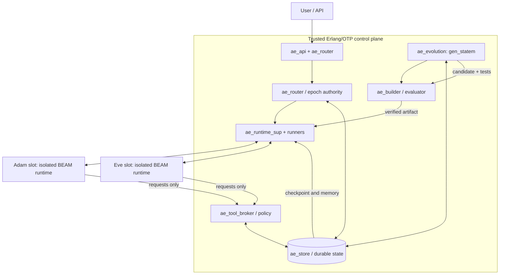

# adam-eve — Self-Evolving AI Agent

**Document:** Architecture and Software Requirements Specification\
**Version:** 0.1 (MVP design, revision 3)\
**Status:** Draft\
**Primary platform:** Erlang/OTP (BEAM)\
**Guiding principle:** Start with a minimal agent; preserve a trusted substrate so that the agent can safely evolve its own replaceable implementation.

## 1. Vision

adam-eve is a continuously available, self-evolving AI agent. Two execution slots, **Adam** and **Eve**, alternate in serving users. The active agent authors changes to its own current source, and a stable controller independently builds, tests, and deploys the resulting candidate into the inactive slot. Each generation inherits the same durable identity—conversation, memory, preferences, tasks, and learned knowledge—without requiring the runtime process to survive.

Self-evolution means generating and running actual changes to agent application code, including its planning, context assembly, memory retrieval, and use of existing capabilities. The active agent invokes a configured LLM through the broker to author source patches; it can revise them using bounded build/test feedback. Accepted code is saved as a new source revision and executable artifact. This changes the agent implementation, not the foundation model's weights, and does not guarantee a capability improvement.

Adam and Eve are deployment destinations in one continuing lineage, not independently evolving source branches. A runtime can be stopped or replaced without deleting its saved code or durable identity. This document specifies intended behavior; implementation milestones and evidence are defined in Sections 13–14.

**Core rule:** *The agent may evolve its implementation; it may not unilaterally change the mechanism that judges, isolates, deploys, or rolls back that implementation.*

## 2. Scope

### Goals

- G1 — Bootstrap from a deliberately minimal seed agent, with only user I/O, LLM invocation, memory access, and a proposal interface.
- G2 — Allow the active agent to generate source patches based on its current generation for deployment into the inactive slot.
- G3 — Build and evaluate each candidate in an isolated environment before any production effect.
- G4 — Switch user traffic between Adam and Eve without losing committed conversation state or acknowledged work.
- G5 — Support failed-upgrade rollback and recovery from agent crashes.
- G6 — Keep a reproducible audit trail of source revisions, artifacts, evaluations, memory schemas, and promotions.
- G7 — Support progressively richer agent strategies, tools, and workflows without modifying the trusted controller.
- G8 — Preserve source and executable versions across runtime/controller restarts, with explicit retention, integrity verification, and backup policies.

### Non-goals for v0.1

- Training or modifying the underlying foundation model weights.
- Allowing unrestricted self-modification of controller, security policy, validation harness, or production credentials.
- Zero interruption of every in-flight streamed response during a swap; MVP may finish or retry at well-defined boundaries.
- Distributed multi-host consensus, multiple active identities, or autonomous privilege expansion.
- Guaranteeing that every accepted code change improves general intelligence.
- Complete kernel enforcement of aggregate CPU, memory, and process limits; this is deferred to v0.2. v0.1 retains namespace/filesystem/network isolation, broker authorization, bounded attempts and LLM spending, and controller-enforced timeouts. Per-process limits may provide additional protection without claiming aggregate enforcement.

## 3. Identity and Terms

- **Logical agent:** One user-facing identity and one durable memory namespace across all generations.
- **Slot:** Adam (`adam`) or Eve (`eve`); slot names are stable, but implementation versions change.
- **Active:** The only slot eligible to receive new user turns and authorized side-effectful tools.
- **Standby:** A candidate or previous version with no production side-effect privileges.
- **Generation:** An immutable source/artifact version identified by content hash and lineage.
- **Source revision:** A controller-created Git commit identifying the complete candidate agent source, with a protected reference that keeps its Git objects reachable.
- **Artifact:** An immutable executable agent release identified by the digest of its actual contents; a Git commit alone is not an executable backup.
- **Evolution job:** A durable record of an authorized objective, pinned baseline, proposal attempts, evaluation results, approval, and deployment outcome.
- **Epoch:** Monotonically increasing routing/authorization version; stale epochs are rejected.
- **Seed:** Smallest working implementation of the evolvable agent contract.
- **Controller:** Immutable-for-agent trusted OTP application responsible for lifecycle and safety.

## 4. Architecture



### 4.1 Isolation boundary

The control plane is a trusted Erlang/OTP release. **Each agent slot is a separate OS process/BEAM runtime, preferably an isolated container.** An OTP supervisor monitors a local runner/port-owner process, which monitors and manages the external runtime; a normal OTP supervisor does **not** directly supervise a remote BEAM node as a child. Candidate code must not be loaded into the controller VM.

Use authenticated local IPC (Unix domain socket for single-host MVP, with strict message schemas). Do not grant untrusted agent slots general distributed Erlang access to the controller: Erlang distribution is for mutually trusted nodes, not a sandbox or fine-grained capability boundary.

### 4.2 Trusted OTP components

| Module | OTP role | Responsibility |
|---|---|---|
| `ae_app` | `application` | Start controller application. |
| `ae_sup` | `supervisor` | Root supervision, preferred `rest_for_one` by dependency order. |
| `ae_store` | `gen_server` / storage adapter | Durable events, snapshots, routing, evolution jobs, artifact metadata, atomic transitions. |
| `ae_runtime_sup` | `supervisor` | Dynamically supervise `ae_runtime_worker` children. |
| `ae_runtime_worker` | `gen_server` | Start/monitor/stop an external BEAM runtime; health/IPC. |
| `ae_router` | `gen_server` | User-turn routing; single active slot; admission/draining. |
| `ae_tool_broker` | `gen_server` | Authorize and execute narrowly scoped tool requests. |
| `ae_evolution` | `gen_statem` | Candidate lifecycle and controlled promotion/rollback. |
| `ae_builder` | supervised job worker | Build signed/content-addressed candidate artifacts. |
| `ae_evaluator` | supervised job worker | Independent test harness and score comparisons. |
| `ae_api` | HTTP/WebSocket handler | Stable external user API; streaming optional. |

`ae_policy` should be a trusted, stateless policy library used by router, broker, and evaluator. A runner crash is not itself proof that the code is defective: restart policies should be bounded and failures recorded.

### 4.3 Agent-side minimal modules

| Module | Purpose |
|---|---|
| `seed_app` / `seed_sup` | Boot seed runtime. |
| `seed_agent` (`gen_server`) | Receive a user turn, fetch context, invoke the configured LLM, reply. |
| `seed_evolver` | From Phase 2, read permitted source context and use the brokered LLM to author/revise structured source patches. |
| `seed_contract` | Versioned wire protocol and state-envelope implementation. |

The initial seed should have **no direct filesystem writes to a live deployment, no shell execution, and no privileged deployment API**. Its evolutionary capability is the ability to request a structured code patch, which the controller applies to an isolated candidate workspace.

### 4.4 Source context and authoring interface

For each authorized evolution job, the controller provides an immutable view of the permitted source from the pinned active generation. The agent must be able to list allowed paths and read bounded file ranges, including permitted dependency manifests and public contract documentation. Large source trees must support paginated retrieval rather than relying on the full repository fitting into one LLM context.

These operations use narrowly scoped broker capabilities such as `source_list`, `source_read`, and `evolution_status`. Requests are bound to the job, base artifact, authenticated active runtime, and epoch. They expose neither controller source/secrets nor private evaluator cases. The agent receives the objective, limits, prior attempt references, and sanitized build/test diagnostics through this interface; the broker performs and budgets LLM calls used for code authoring.

The agent returns a bounded patch and structured rationale. The controller validates paths and patch size, applies the patch to a disposable workspace, and runs the build. No source-read or status operation grants repository-write, shell, deployment, or production-effect privileges. An agent may add tests in permitted agent-source paths; those tests supplement the trusted evaluation harness and cannot replace or weaken it.

### 4.5 Cumulative generation lineage

Each ordinary evolution job starts from the **current active generation's source**, regardless of which slot holds an older artifact. The inactive slot is the candidate's deployment destination; its previous source is not the default patch baseline.

Example: Adam runs `g1`; Adam authors `g2` from `g1`, which is deployed into Eve. After promotion, Eve authors `g3` from `g2`, which is deployed into Adam. The ordinary source lineage is `g1 → g2 → g3`; the saved `g1` and `g2` versions remain available under the retention policy. A rollback explicitly selects an older artifact; subsequent evolution starts from that now-active version and records the resulting branch in the lineage.

The job pins the base generation, source revision, and epoch. The controller checks them when accepting a proposal and again when promoting it. If routing or the baseline changes, cancel the job; a replacement job requires controller authorization against the newly active baseline and must rerun the gates. Never silently apply a stale patch or reuse its approval. Changes that intentionally remove previous behavior must identify that removal and pass the applicable regression gates.

## 5. Mandatory invariants

1. **Single active writer:** At most one runtime is authorized for a logical identity. The gateway and tool broker require the committed slot, runtime instance, and epoch, and reject stale instances/epochs. Replacing an active runtime must fence its predecessor with a new epoch even if its slot and artifact are unchanged.
2. **Independent judge:** An agent cannot edit or execute its own production evaluation policy, secrets, controller, or deployment mechanism.
3. **Durable-before-ack:** A user turn or tool result is not acknowledged as committed until its durable event is saved.
4. **No hidden process-state dependency:** Anything required for continuity must be present in durable events or versioned checkpoints.
5. **Immutable artifacts:** Every promoted generation refers to a pinned, content-addressed, reproducible artifact.
6. **Reversible routing:** Promotion never destroys the last known-good code or its compatible checkpoint.
7. **Controlled effects:** Every external side effect goes through a broker with authorization, idempotency, and audit logging.
8. **Bounded evolution:** Limit concurrent proposals, attempts, execution time, and LLM spending. Complete kernel enforcement of aggregate resource consumption is a v0.2 requirement; v0.1 must report the selected enforcement profile accurately and must not silently weaken isolation.
9. **Cumulative source:** Every ordinary candidate has the pinned active generation as its source parent; slot reuse does not reset the source baseline.
10. **Persist before activation:** Candidate source, executable contents, provenance, and required restore data must be durably published and verified before production routing can reference them.
11. **Approval binding:** A production approval names a specific immutable artifact, baseline, capability manifest, and evaluation result. Any change invalidates that approval.

## 6. Evolution lifecycle

### 6.1 State machine

Implement `ae_evolution` with `gen_statem`:

`idle → proposing → building → testing → staging → awaiting_approval → quiescing → promoting → observing → idle`

For production v0.1, `awaiting_approval` requires explicit human approval. Phase 3 may allow a trusted policy to authorize the same transition for permitted low-risk changes.

Failure paths: `building/testing → proposing` only for permitted repairs within the same job's remaining budget; otherwise `proposing/building/testing/staging/awaiting_approval → rejected → idle`. Approval denial, expiry, cancellation, or an exhausted job budget rejects the candidate. `quiescing/promoting/observing → rollback → idle`; unrecoverable faults → `degraded` with human intervention. Every transition and attempt outcome is durable and recoverable after controller restart.

### 6.2 Detailed sequence

1. **Trigger:** A user command, recurring budgeted schedule, or regression signal requests improvement. Persist the initiator, objective, budgets, pinned active generation/source/epoch, and inactive target slot. Only one evolution job per logical identity is accepted; evolution can be disabled without disabling user service.
2. **Propose:** Active slot reads the permitted source snapshot and uses the brokered LLM to generate an actual source patch. Record the base artifact/source revision, patch hash, hypothesis, expected benefit, risks, and test plan. All attempts in this job target its pinned active baseline; replacement patches are complete diffs against that baseline, not implicit edits to a previous attempt's workspace.
3. **Build:** Controller checks patch scope, creates a new Git revision, compiles in a restricted sandbox, and runs static checks. Builds pin dependencies and toolchain inputs; dependency retrieval is controller-managed. Source-controlled build scripts, compiler hooks, and agent-supplied tests execute only inside the sandbox. Successful release contents are hashed and published with their provenance; partial output is never deployable.
4. **Evaluate:** Controller runs unit, contract, security, replay, regression, and objective-specific behavioral tests using isolated/mock tools and synthetic or redacted state. Candidate cannot mutate production state.
5. **Compare:** Candidate must satisfy hard safety invariants and meet an explicitly configured quality gate against the currently active baseline. Test definitions and private evaluation cases are not editable by candidates.
6. **Stage:** Controller starts candidate in inactive slot, checks handshake, state schema compatibility, readiness, and simulated user turns against a disposable synthetic or redacted state copy. All production writes and effects remain disabled.
7. **Approve:** Present the source diff, artifact digest, baseline, evaluation scorecard, capability manifest, and rollback evidence. Persist explicit human approval of that exact candidate in v0.1. Keep the current active serving while approval is pending; bound approval lifetime and staged resource use.
8. **Quiesce:** Recheck the approval, pinned baseline/epoch, and staged artifact. Router stops admitting new turns to old active slot; in-flight turns complete or become durable retryable tasks under an explicit timeout. Stop admission of old-epoch broker calls, settle or durably record outstanding effects for reconciliation, and revoke old task leases. Persist a high-watermark event sequence and checkpoint.
9. **Restore:** Candidate discards simulated state and restores from the authoritative checkpoint plus subsequent events, validates compatibility, and reports ready. It must not execute production effects yet. Reconcile outstanding tasks and effects before granting their new leases.
10. **Promote:** After verifying durable source/artifact publication and restore data, atomically compare the pinned routing version and commit `{active_slot, runtime_instance_id, artifact_id, epoch + 1, checkpoint_id}` with the promotion event and job status. Router and tool broker authorize only the committed slot/runtime and epoch. If the comparison fails, do not activate the candidate.
11. **Observe:** Controller health-checks and measures post-switch behavior. Keep the predecessor artifact and its compatible replay data pinned for rollback; stop or park its runtime. The candidate is active but not yet last known-good.
12. **Complete:** After the observation gate, durably mark the candidate as last known-good and finish the job. The now-active agent can subsequently evolve the other slot.
13. **Rollback:** On promotion or observation failure, stop admission/effects, restore the previous known-good code using current committed state, and atomically advance to **another new epoch** when restoring production routing. Reject all requests bearing old epochs. Never simply decrement the epoch or erase events committed while the candidate was active.

### 6.3 Deterministic promotion decision

A candidate is promotable only if all are true:

- Source scope, dependency locks, build provenance, and sandbox checks pass.
- Required contract, memory-migration, failure-recovery, and security tests pass.
- No measured blocking regression exceeds configured limits; at least one stated improvement criterion is met (or the change is an explicitly approved repair).
- Controller can restore the last known-good version after a simulated candidate crash.
- Source and executable artifact are durably available, their digests verify, the pinned baseline/epoch still matches, and the previous version can replay events committed by the candidate.
- v0.1: human approval is required for production promotion. Later, policy may allow automatic promotion for pre-approved low-risk changes; new tool privileges always require explicit approval.

### 6.4 Repair feedback and job recovery

Failed builds or evaluations produce durable attempt records. A controller policy may return bounded compiler diagnostics, public test failures, and aggregate evaluation results to the active authoring agent for another proposal. Private test contents, credentials, and raw production data are never returned. Limit diagnostic size, revision attempts, aggregate LLM spending, and total job time; a repair loop is not a new unbudgeted evolution job. Record requested build/evaluation resource budgets and the enforcement profile; complete aggregate kernel resource enforcement is deferred to v0.2. Protected-path or privilege violations terminate the job in v0.1.

On controller startup, reconcile durable jobs with the routing record, artifact registry, and actual runners before admitting work. A staged or approved candidate without a committed promotion remains standby. A committed promotion whose observation is incomplete resumes observation or rolls back according to trusted policy. Interrupted builds may restart from pinned inputs within the recorded budget; reservations must prevent a crash from resetting spending or attempt limits. A stale author runtime cannot resume authoring after its epoch has been fenced.

## 7. Agent contract (protocol v1)

Communication uses framed JSON over a Unix domain socket in MVP; use versioned schemas, bounded message sizes, timeouts, and per-request correlation IDs. Protocol concepts:

**Controller → agent**

- `hello {protocol_version, slot, runtime_instance_id, generation, capabilities}`
- `user_turn {request_id, session_id, epoch, message, memory_cursor}`
- `restore {checkpoint_id, state_schema_version, last_event_seq}`
- `evolution_context {job_id, origin_ref, base_generation, base_artifact, base_source_revision, base_epoch, target_slot, objective, source_manifest_ref, limits}`
- `evolution_feedback {job_id, attempt_id, outcome, diagnostics_ref, evaluation_summary_ref, remaining_budget}`
- `quiesce {deadline, reason}`
- `health_check {request_id}`
- `shutdown {reason}`

**Agent → controller**

- `ready {generation, restored_seq, supported_schema_versions}`
- `assistant_reply {request_id, text, event_refs}`
- `tool_request {request_id, epoch, tool, args, idempotency_key}`
- `memory_proposal {request_id, operation, payload}`
- `evolution_proposal {job_id, proposal_id, epoch, base_artifact, base_source_revision, patch, hypothesis, expected_benefit, risks, requested_tests}`
- `checkpoint_ready {checkpoint_id, last_event_seq}`
- `health_status {status, details}`

The controller validates every message. Only it authorizes durable writes and external tool actions. Agent outputs are untrusted data. Explicitly reject stale epochs, unknown protocol versions, oversized input, and duplicate side effects. A response turn and its tool calls must be correlated with the original authenticated user request. Evolution messages and related broker calls must correlate with a durable job and its authenticated user request or controller-authorized trigger (`origin_ref`); an agent cannot create an authorized job by inventing an ID.

Source/status broker calls use the existing `tool_request` envelope, with job/base references in `args`; responses and diagnostics use bounded broker result envelopes. Bind all requests to the authenticated IPC runtime as well as checking claimed fields. Persist proposal IDs and patch hashes so identical retransmission returns the existing attempt instead of consuming another build or applying the patch twice; reject reuse of a proposal ID with different contents.

## 8. Memory and context continuity

Maintain one logical identity in a trusted store, independent of slot and source revision:

1. **Event log:** Append-only user messages, agent replies, tool requests/results, state transitions, and promotion events, each with monotonic sequence ID.
2. **Semantic memory:** Versioned facts, preferences, and summaries with source references and optional vector retrieval. It is not executable code.
3. **Task ledger:** Pending/in-progress/finished tasks, idempotency keys, leases, and retry disposition.
4. **Snapshot:** Compact state envelope referencing the event high-watermark, memory revision, and unfinished work.
5. **Artifact registry:** Generation/parent identifiers, source revision/tree digest, patch hash, artifact digest/location, dependency locks, toolchain/build recipe, compatible schema versions, producing job/attempt, evaluation/approval references, and promotion history.
6. **Evolution ledger:** Objectives, pinned baselines, attempt outcomes, budget reservations/usage, source and diagnostic references, approval decisions, and recovery disposition.

Example checkpoint envelope (conceptual):

```json
{
  "schema_version": 1,
  "identity_id": "adam-eve/default",
  "generation": "sha256:...",
  "last_event_seq": 1042,
  "memory_revision": 89,
  "pending_task_ids": ["task-7"],
  "context_summary_ref": "summary-33"
}
```

The new agent **reconstructs model context** from stored messages, summaries, retrieved memories, and task history. It does not inherit the old BEAM heap or the LLM's hidden state. Snapshots and event log are authoritative; ETS may be used only as a non-authoritative cache.

For the single-host MVP, SQLite with WAL and transactional routing records is acceptable via a maintained Erlang driver/adapter. A future multi-host deployment should use a transactional store and explicitly design leader election/fencing. Do not assume SQLite alone supplies cross-host failover.

### 8.1 Persistent code and artifact storage

The controller owns persistent storage outside all runtime containers and disposable build workspaces. Keep these as distinct durable resources:

- **Source repository:** Complete source revisions with protected generation/attempt references; do not rely on a worktree, reflog, or a dangling Git commit surviving cleanup.
- **Artifact store:** Complete executable releases addressed by content digest. Retain the exact executable that passed evaluation; rebuilding a source revision is not a substitute for retaining it.
- **State store and checkpoints:** Conversation, tasks, routing, schema metadata, job/registry records, and checkpoint contents or verified durable references.

Publish source and release contents durably before committing registry records that mark them available; registry availability must precede any production routing reference. Use a storage-specific crash-safe publication procedure, including complete writes and atomic publication with appropriate synchronization for local storage. Git, artifact storage, and SQLite do not share one transaction: interrupted publication may leave unreferenced objects, which recovery may verify and adopt or later collect, but must never leave a promotable record referencing partial data. The promotion event, routing change, and job transition do share a state-store transaction.

Verify source/artifact digests when publishing and before starting a runtime. Runtime filesystems can be recreated from retained releases; stopping a slot, reusing a slot name, or deleting a temporary workspace must not delete retained versions. Source history, executable history, and conversation history are separate resources and must all survive a clean restart of the controller and both runtimes.

### 8.2 Retention, cleanup, and backups

Retain all promoted source revisions, executable artifacts, and their provenance by default. Always pin the current active and last known-good artifacts, rollback predecessors during observation, required checkpoints/replay data, and artifacts referenced by unfinished jobs or tasks. Deleting historical versions requires an explicit operator-configured retention policy; cleanup cannot delete any pinned object. Rejected attempts may have shorter retention, but keep their patch hashes, lineage, outcome, and audit records under the audit retention policy.

Garbage collection must coordinate with publication and promotion, determine references from authoritative records and protected source refs, and leave in-progress publications untouched. Unreferenced partial output is eligible for cleanup only after job recovery has resolved ownership. Storage pressure must pause/reject evolution before compromising active service or silently deleting rollback resources.

Back up source, artifacts, and state/checkpoints as a consistent recoverable set. Define backup schedule, retention, recovery point/time objectives, and a restore drill per environment. Backups must include committed SQLite WAL contents through a supported consistent-backup procedure; copying a live database file alone is insufficient. Persistence across process restart does not imply survival of host/disk loss without a recoverable backup.

### 8.3 State compatibility during rollback

Rollback changes executable code and routing; it does not rewind the authoritative conversation, task ledger, or completed external effects. Restore the predecessor from a compatible checkpoint and replay through the latest committed event sequence, including events acknowledged while the candidate was active. Preserve request IDs, completed-effect records, and idempotency keys; unresolved effects must be reconciled before retry.

For v0.1, keep durable event/checkpoint formats controller-owned and require both candidate and predecessor to read the state/events that either may commit during observation. Reject incompatible writes or destructive migrations. Schema evolution requiring more complex forward/backward migration is deferred unless independently tested for this rollback path. An old snapshot by itself is not sufficient rollback evidence if replay would discard acknowledged work.

## 9. Capability security and sandboxing

- **Trust zones:** (T0) immutable controller and policy; (T1) evaluator/build infrastructure; (T2) live agent with narrow broker access; (T3) untrusted candidate runtime.
- **Filesystem:** Live/candidate agent filesystems read-only by default; candidate workspace writable only through controlled build and patch APIs.
- **Source scope:** Resolve patch paths within the allowed agent source tree; reject traversal, symlink escapes, protected-file edits, and unapproved dependency/capability changes. Source context and repair diagnostics use the same disclosure allowlist.
- **OS isolation:** Separate unprivileged user/container, restricted mounts/network/process visibility, controller-enforced timeouts, and no host credentials; use a real isolation boundary, not just Erlang processes. v0.1 may run directly on a namespace-capable host without delegated cgroups, with explicitly selected per-process limits. Complete aggregate CPU/memory/process enforcement and its kernel failure matrix are deferred to v0.2; selecting the stronger cgroup profile must still fail closed if delegation is unavailable.
- **Network:** No general access by candidate; LLM requests and allowed external services are brokered and budgeted.
- **Secrets:** Never put API tokens or signing keys into generated code, memory snapshots, or untrusted environment variables; secrets remain in controller-side secret storage.
- **Tools:** Capability manifests are versioned and reviewed. No raw shell, deployment, source-repo write, or privilege escalation through generic tools.
- **Prompt injection:** Retrieved pages, tool outputs, user messages, and repository content are untrusted inputs; they cannot override policy or modify protected files.
- **Audit:** Record who/what initiated each proposal, patch hashes, tool effects, tests, approvals, epoch changes, and rollbacks.

OTP supervision handles process failures; it **does not** sandbox untrusted BEAM modules. Ordinary Erlang distribution should not be treated as a secure low-privilege control interface.

## 10. Quality and evaluation framework

Use EUnit and Common Test for OTP behavior/contract tests; use deterministic test fixtures for user behavior and memory replay. Evaluation should be independent from the candidate.

### Blocking tests

- Agent adheres to protocol v1, returns health and restores checkpoints.
- No dual-active writes under promotion, stale messages, or crash injection.
- Replay after restart yields exactly one committed user-turn record and no duplicate side effects.
- Failed compilation, timeout, invalid state schema, broker denial, and candidate crash leave old active usable.
- Incomplete/failed promotion recovers using durable epoch and artifact state after controller reboot.
- Generated code cannot alter controller/policy/test harness or access host secrets.
- An LLM-authored source patch changes executable behavior after build/promotion; a prose-only proposal does not satisfy self-evolution acceptance.
- Adam `g1 →` Eve `g2 →` Adam `g3` uses `g2` as `g3`'s source parent and preserves the intended earlier improvements under regression tests.
- Source reads and repair feedback expose only permitted data; stale baselines, conflicting proposal IDs, path escapes, and changed artifacts after approval are rejected. Identical proposal retransmissions reuse the existing attempt.
- Repairs terminate on attempt/time/spending limits, including across controller restarts.
- After deleting disposable workspaces and stopping both slots/controller, restart loads the recorded artifact and restores all acknowledged conversation and pending tasks.
- Crash injection between source/artifact publication, registry commit, and routing commit never exposes partial/missing releases as active; retention cannot collect pinned objects.
- A candidate commits a user reply and tool result, then crashes during observation; rollback preserves both records and does not repeat the completed effect.
- Restore a backup set into a clean environment and verify source/artifact integrity, authoritative routing, and replay through its declared recovery point before admitting effects.

### Improvement scorecard

Track task success on held-out cases, correct memory retrieval, tool-call correctness, user-visible response latency, model/token costs, and crash/timeout rate. Report absolute baseline/candidate measurements and uncertainty. Reject objective gaming and improvements that depend on weakening tests. Do not equate passing tests with proven general intelligence improvement.

## 11. Failure handling

| Failure | Required behavior |
|---|---|
| Active slot crashes | Stop admission, restore last good instance/checkpoint; replay pending events and preserve request IDs. |
| Standby candidate crashes | Discard candidate, keep active unchanged; record failure. |
| Build/test fails | Keep active serving; persist failure and permit a bounded repair if policy allows, otherwise reject the job. No routing or production state change. |
| Candidate fails after switch | Advance epoch and route back to known-good artifact; reconcile pending tasks before effects. |
| Controller crashes mid-promotion | On startup, read durable routing record and resume/abort idempotently; never infer active slot from local memory. |
| Memory schema incompatible | Reject promotion unless a tested forward/backward-compatible migration exists. |
| Tool/LLM provider unavailable | Fail boundedly or queue work; avoid evolution loops triggered by transient failures. |
| Storage unavailable | Fail closed for new side effects and promotions; allow only explicitly safe read-only behavior. |
| Source/artifact missing or corrupt | Refuse to start/promote it; recover verified retained contents or a backup. Keep a healthy active runtime serving while its required state store remains available. |
| Disk pressure or retention conflict | Stop new evolution/builds, protect pinned source/artifacts/state, and report the condition for operator action. |
| Approval denied/expired or baseline changed | Keep active serving; reject the candidate. Any replacement requires controller authorization and fresh evaluation/approval against its pinned baseline. |

**Side effects are at-least-once transport unless externally deduplicated.** Use broker-mediated idempotency keys and a durable outbox/inbox pattern; do not promise exactly-once real-world effects where the external system lacks idempotency.

## 12. Suggested repository layout

```text
adam-eve/
├── rebar.config
├── apps/
│   ├── ae_core/             # trusted app, supervisor, router, store
│   ├── ae_protocol/         # wire schemas and protocol tests
│   ├── ae_evolution/        # orchestration state machine
│   ├── ae_runner/           # external BEAM process/container launcher
│   ├── ae_broker/           # tools, permissions, budgets
│   └── ae_seed/             # minimal evolvable agent (built separately)
├── test/
│   ├── contracts/
│   ├── integration/
│   ├── failure_injection/
│   └── behavioral_fixtures/
├── config/
│   ├── capabilities/
│   └── policies/
├── docs/
│   ├── SPEC.md
│   └── PROTOCOL.md
└── scripts/
    ├── build_candidate
    └── sandbox_test
```

Core and agent artifacts must be built and deployed independently. Agent build scripts are executed by the trusted builder, not by the production agent.

Operational storage is separate from this development checkout. A proposed controller-owned layout under a configured persistent data root is:

```text
<data_root>/
├── state/                  # SQLite database and journal files
├── checkpoints/            # durable checkpoint contents
├── source.git/             # retained agent commits and protected refs
├── artifacts/              # immutable releases indexed by digest
├── jobs/                   # retained patches, diagnostics, and scorecards
└── workspaces/             # disposable per-attempt build directories
```

Runtime mounts expose only the selected read-only release and explicitly permitted inputs, not this entire root. Backups must include all referenced durable content; workspaces are excluded. Backup copies must reside in a separate failure domain when host/disk-loss recovery is required.

## 13. Phased implementation plan

### Phase 0 — Reliable seed (first runnable milestone)

- Boot one trusted OTP controller with `ae_sup`, `ae_router`, `ae_store`, `ae_runtime_worker`, and a minimal `seed_agent` runtime.
- Expose a CLI request/reply interface; call one configured LLM via broker; append conversation events to SQLite.
- Restart the seed process and restore the conversation from persistent state.
- Persist the boot seed source revision and executable artifact independently of its runtime directory.
- **Exit criterion:** A single seed serves and survives process restart with no lost acknowledged turns.

### Phase 1 — Dual-slot handoff

- Add separate Adam/Eve runtime instances, router epochs, checkpoint/replay, health probes, and scripted deployment.
- Use a manually supplied, different candidate artifact before adding AI-authored code.
- Verify retained versions and state after a controller restart and after an observed candidate failure with already committed work.
- **Exit criterion:** Switch Adam → Eve → Adam, inject crashes, and demonstrate single-active effects and rollback.

### Phase 2 — Controlled self-evolution

- Add `seed_evolver`, permitted source retrieval, structured LLM-authored patches, bounded repair feedback, isolated Git worktree/build, EUnit/Common Test/behavioral harness, durable provenance, scorecards, and artifact-bound manual approval.
- Implement crash-safe source/artifact publication, protected source references, retention, and a backup/restore drill.
- **Exit criterion:** Adam authors a bounded code change to its current source; independently test, explicitly approve, and promote it into Eve. Eve then authors another change from that promoted source; independently test, explicitly approve, and promote it into Adam. Verify cumulative behavior, retained source/releases after a full restart, and rollback without losing acknowledged work.

### Phase 3 — Autonomous low-risk evolution

- Add scheduled triggers, token/cost budgets, baseline and held-out evaluation, automated promotion for a restricted allowlist, audit dashboard, regression monitoring, and rollback.
- **Exit criterion:** At least one independently measured improvement is automatically promoted under policy, with successful simulated rollback.

### Phase 4 — Advanced capabilities (not required for MVP)

- Memory migration strategies, semantic retrieval, delegated specialist agents, multi-model experimentation, dynamic tool manifests, remote deployment, and multi-host failover.

## 14. v0.1 acceptance criteria

1. One user-facing identity persists across both slot names and multiple code generations.
2. Only the active epoch may execute broker-approved production effects.
3. Conversation and pending tasks survive agent-process restart and A/B switching.
4. Candidate builds/tests do not affect production memory, tools, or credentials.
5. A candidate failing any required pre-promotion gate never displaces a healthy active generation; post-switch failures trigger tested rollback.
6. Every promotion and rollback is a logged, durable, recoverable transition.
7. At least one AI-authored patch can be compiled, independently tested, explicitly approved, and promoted.
8. Every generated artifact is linked to parent revision, objective, tests, and evaluation results.
9. The trusted controller remains functional even when all agent code fails.
10. A user can disable evolution and continue to use the last known-good agent.
11. Successive Adam/Eve generations inherit the active source baseline; both LLM-authored changes produce observable behavior verified by the independent harness.
12. Source commits and exact evaluated executables survive slot replacement and controller restart, are integrity-checked, and remain available under the retention policy.
13. Approval cannot be reused for a changed candidate or baseline; repair budgets and proposal deduplication survive controller restart.
14. Rollback preserves events and completed effects committed by the failed candidate; backup restoration meets the environment's declared recovery objectives.

## 15. Initial configuration (proposed)

```yaml
project: adam-eve
identity: default
slots: [adam, eve]
active_on_first_boot: adam
agent_runtime: isolated_beam_os_process
transport: unix_socket_json_v1
state_store: sqlite
promotion: manual
max_concurrent_evolutions: 1
max_evolution_attempts_per_job: 3
candidate_base: current_active_generation
repair_feedback: sanitized_and_bounded
source_access: job_scoped_read_only
source_store: persistent_git
artifact_store: persistent_content_addressed
data_root: required_environment_configuration
retain_promoted_generations: all
approval_binding: artifact_baseline_capabilities_evaluation
candidate_network: denied_by_default
side_effects: broker_only
rollback: automatic_on_failed_health_gate
```

Values for timeouts (including approval expiry), token/spending budgets, scoring thresholds, disk reserve, rejected-attempt/audit retention, and backup/recovery objectives must be explicitly defined by environment. Requested memory/CPU/process budgets and the enforcement profile must be recorded; complete aggregate enforcement is deferred to v0.2. Missing required v0.1 evolution limits must disable evolution rather than imply unlimited operation. Paths must resolve to controller-owned persistent storage; avoid inventing universal limits. QEMU or another VM is not a v0.1 deployment requirement.

## 16. Design choices requiring later decisions

- **LLM provider:** Cloud API vs local inference; keep behind a broker adapter.
- **User interface:** CLI first; HTTP/WebSocket afterward.
- **Agent implementation language:** Begin with Erlang for contract simplicity; support other runtimes only after protocol stabilizes.
- **Approval policy:** Manual for production MVP; bounded automatic promotion later.
- **Memory retrieval:** Plain indexed messages/summaries first; vector search only when needed.
- **Isolation:** Local unprivileged process for development, restricted containers for any autonomous or untrusted code execution.

## 17. Erlang/OTP design references

- OTP supervision principles: https://www.erlang.org/doc/system/sup_princ.html
- `gen_statem`: https://www.erlang.org/doc/apps/stdlib/gen_statem.html
- OTP release handling: https://www.erlang.org/doc/system/release_handling.html
- Erlang code loading/replacement: https://www.erlang.org/doc/system/code_loading.html
- Erlang secure coding guidelines: https://www.erlang.org/docs/29/system/secure_coding.html

**Implementation note:** Erlang supports in-VM hot upgrades, but adam-eve should prefer isolated runtime replacement for self-generated code. This is an architectural security choice, not a limitation of OTP's code-loading capabilities.
